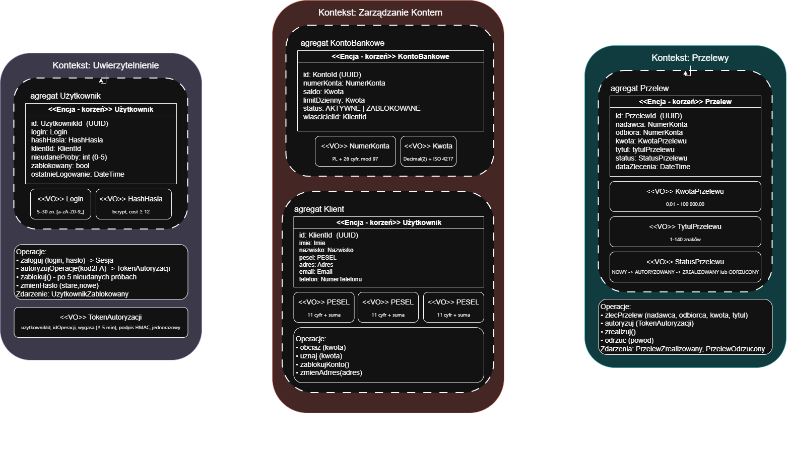

# Zadanie 1 – Domain Driven Design

## Opis zadania

Celem zadania jest zamodelowanie bezpiecznej aplikacji bankowej (fragmentu) wykorzystując zasady Domain Driven Design.
Wybranym fragmentem jest wykonanie przelewu wewnętrznego, który jest jedną z najważniejszych funkcjonalności aplikacji bankowych. Model dzieli system na trzy konteksty ograniczone (Uwierzytelnianie, Zarządzanie Kontem, Przelewy), w których wyróżniono agregaty, encje i obiekty wartości.
Dla każdego obiektu zdefiniowano dopuszczalne formaty danych oraz weryfikację niepoprawnych danych atk, aby były odrzucane już w momencie tworzenia obiektu domenowego (*security by design*).

## Model

## Konteksty ograniczone (Bounded Contexts)

| Kontekst | Odpowiedzialność | Agregaty |
|---|---|---|
| **Uwierzytelnianie** | Logowanie, blokada konta użytkownika po nieudanych próbach, wydawanie tokenów autoryzujących operacje (2FA) | `Uzytkownik` |
| **Zarządzanie Kontem** | Dane klienta, rachunki bankowe, saldo, limity | `KontoBankowe`, `Klient` |
| **Przelewy** | Zlecanie, autoryzacja, realizacja i odrzucanie przelewów | `Przelew` |

## Agregaty, encje i obiekty wartości

| Element | Typ | Kontekst | Uwagi |
|---|---|---|---|
| `Uzytkownik` | Encja – korzeń agregatu | Uwierzytelnianie | Tożsamość logowania, powiązana z klientem tylko przez `KlientId` |
| `KontoBankowe` | Encja – korzeń agregatu | Zarządzanie Kontem | Jedyne miejsce zmiany salda |
| `Klient` | Encja – korzeń agregatu | Zarządzanie Kontem | Właściciel kont (odwołanie przez `KlientId`) |
| `Przelew` | Encja – korzeń agregatu | Przelewy | Odwołuje się do kont tylko przez `NumerKonta`, nie trzyma obiektów `KontoBankowe` |
| `Login`, `HashHasla`, `TokenAutoryzacji` | Obiekty wartości | Uwierzytelnianie | Niemutowalne |
| `NumerKonta`, `Kwota`, `PESEL`, `Adres`, `Email`, `Imie`, `Nazwisko`, `NumerTelefonu` | Obiekty wartości | Zarządzanie Kontem | Niemutowalne, porównywane po wartości |
| `KwotaPrzelewu`, `TytulPrzelewu`, `StatusPrzelewu` | Obiekty wartości | Przelewy | Niemutowalne |

## Przyjęte założenia – atrybuty i formaty danych

### Identyfikatory

| Atrybut | Format | Uzasadnienie |
|---|---|---|
| `UzytkownikId`, `KlientId`, `KontoId`, `PrzelewId` | UUID v4 | Nieprzewidywalne – utrudniają enumerację zasobów (IDOR) |

### Kontekst: Uwierzytelnianie

| Obiekt | Atrybut | Ograniczenia / format |
|---|---|---|
| `Login` | wartość | 5–30 znaków, tylko `[a-zA-Z0-9_]`, unikalny, porównywany bez rozróżniania wielkości liter |
| `HashHasla` | wartość | Hash bcrypt (cost ≥ 12, 60 znaków). Hasło jawne nigdy nie jest przechowywane ani logowane. Hasło przy ustawianiu: 12–128 znaków, min. 1 wielka litera, 1 mała, 1 cyfra, 1 znak specjalny |
| `Uzytkownik` | nieudaneProby | Liczba całkowita 0–5; przy 5 → `zablokowany = true` |
| `Uzytkownik` | zablokowany | `bool`; zablokowany użytkownik nie może się zalogować ani autoryzować operacji |
| `TokenAutoryzacji` | uzytkownikId, idOperacji, wygasa, podpis | Ważny maks. 5 min, jednorazowy, powiązany z konkretną operacją (`idOperacji`), podpisany HMAC-SHA256 |

### Kontekst: Zarządzanie Kontem

| Obiekt | Atrybut | Ograniczenia / format |
|---|---|---|
| `NumerKonta` | iban | Format `PL` + 26 cyfr (bez spacji po normalizacji), poprawna suma kontrolna IBAN (mod 97 = 1) |
| `Kwota` | wartość | `Decimal`, dokładnie 2 miejsca po przecinku (nigdy `float`) |
| `Kwota` | waluta | Kod ISO 4217 – w modelu dopuszczalne `PLN`, `EUR`, `USD` |
| `KontoBankowe` | saldo | `Kwota` ≥ 0 (brak debetu) |
| `KontoBankowe` | limitDzienny | `Kwota` w przedziale 0–100 000,00 |
| `KontoBankowe` | status | Enum: `AKTYWNE`, `ZABLOKOWANE` |
| `Imie`, `Nazwisko` | wartość | 2–50 znaków, litery (w tym polskie znaki), dopuszczalne `-`, spacja i `'` w nazwisku; brak znaków `< > " ; &` |
| `PESEL` | wartość | Dokładnie 11 cyfr, poprawna cyfra kontrolna, poprawna data urodzenia zakodowana w numerze |
| `Adres` | ulica | 1–100 znaków, litery, cyfry, spacja, `.`, `-`, `/` |
| `Adres` | numerDomu / numerLokalu | 1–10 znaków `[0-9A-Za-z/]`; lokal opcjonalny |
| `Adres` | kodPocztowy | Format `NN-NNN` (regex `^\d{2}-\d{3}$`) |
| `Adres` | miasto | 2–50 znaków, litery, spacja, `-` |
| `Adres` | kraj | Kod ISO 3166-1 alpha-2 (np. `PL`) |
| `Email` | wartość | Zgodny z RFC 5322, maks. 254 znaki, zapisywany małymi literami |
| `NumerTelefonu` | wartość | Format E.164: `+` i 9–15 cyfr |

### Kontekst: Przelewy

| Obiekt | Atrybut | Ograniczenia / format |
|---|---|---|
| `Przelew` | nadawca, odbiorca | `NumerKonta`; nadawca ≠ odbiorca |
| `KwotaPrzelewu` | wartość | `Decimal(2)`, 0,01 – 100 000,00; nie może przekroczyć salda ani pozostałego limitu dziennego nadawcy |
| `KwotaPrzelewu` | waluta | Musi być zgodna z walutą konta nadawcy |
| `TytulPrzelewu` | wartość | 1–140 znaków; dozwolone litery (w tym polskie), cyfry, spacja i `.,-/:()`; znaki `< > " ' ; &` są odrzucane (ochrona przed XSS/injection) |
| `StatusPrzelewu` | wartość | Enum; dozwolone przejścia: `NOWY → AUTORYZOWANY → ZREALIZOWANY` oraz `NOWY/AUTORYZOWANY → ODRZUCONY`. Inne przejścia są zabronione |
| `Przelew` | dataZlecenia | Znacznik czasu UTC (ISO 8601) nadawany przez serwer, nie przez klienta |

## Niezmienniki (reguły biznesowe)

1. Saldo konta nigdy nie może być ujemne – `obciaz()` odrzuca operację przy braku środków.
2. Przelew można zrealizować tylko w statusie `AUTORYZOWANY`.
3. Przelew może zlecić tylko użytkownik, którego `KlientId` jest właścicielem konta nadawcy.
4. Konto w statusie `ZABLOKOWANE` nie może być obciążane.
5. Obiekty wartości są niemutowalne – zmiana (np. adresu) oznacza utworzenie nowego obiektu, który ponownie przechodzi walidację.
6. Walidacja odbywa się w konstruktorach / fabrykach obiektów domenowych – nie da się utworzyć obiektu w niepoprawnym stanie.

## Integracja między kontekstami

| Z kontekstu | Do kontekstu | Operacja / dane | Opis |
|---|---|---|---|
| Uwierzytelnianie | Zarządzanie Kontem | `KlientId` | Po zalogowaniu sesja zna tylko `KlientId`; dane klienta pobierane są z kontekstu Zarządzanie Kontem |
| Uwierzytelnianie | Przelewy | `TokenAutoryzacji` | `Przelew.autoryzuj(token)` wymaga ważnego, jednorazowego tokenu wydanego dla tego `idOperacji` |
| Przelewy | Zarządzanie Kontem | `obciaz(numerKonta, kwota)` | Obciążenie konta nadawcy; w razie błędu przelew → `ODRZUCONY` |
| Przelewy | Zarządzanie Kontem | `uznaj(numerKonta, kwota)` | Uznanie konta odbiorcy po udanym obciążeniu |
| Przelewy | (inne konteksty) | Zdarzenia `PrzelewZrealizowany`, `PrzelewOdrzucony` | Publikowane np. dla powiadomień lub audytu |
| Uwierzytelnianie | (inne konteksty) | Zdarzenie `UzytkownikZablokowany` | Np. powiadomienie klienta o blokadzie |

Konteksty komunikują się wyłącznie przez identyfikatory i obiekty wartości – żaden kontekst nie modyfikuje bezpośrednio agregatu innego kontekstu.

## Przebieg przelewu (scenariusz)

1. Użytkownik loguje się (`zaloguj`) – kontekst **Uwierzytelnianie**.
2. Użytkownik zleca przelew (`zlecPrzelew`) – tworzony jest `Przelew` w statusie `NOWY`; obiekty wartości walidują format numerów kont, kwoty i tytułu.
3. Użytkownik potwierdza operację kodem 2FA → otrzymuje `TokenAutoryzacji`; `Przelew.autoryzuj(token)` → `AUTORYZOWANY`.
4. `Przelew.zrealizuj()` wywołuje `obciaz()` na koncie nadawcy i `uznaj()` na koncie odbiorcy – kontekst **Zarządzanie Kontem**.
5. Status zmienia się na `ZREALIZOWANY` (lub `ODRZUCONY` przy błędzie) i publikowane jest odpowiednie zdarzenie.
