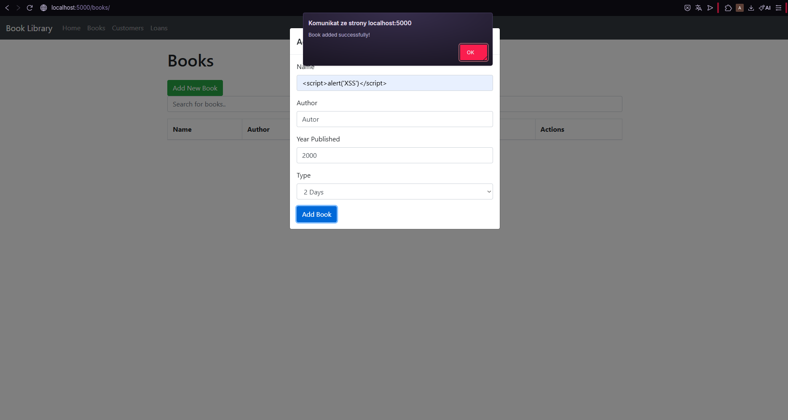
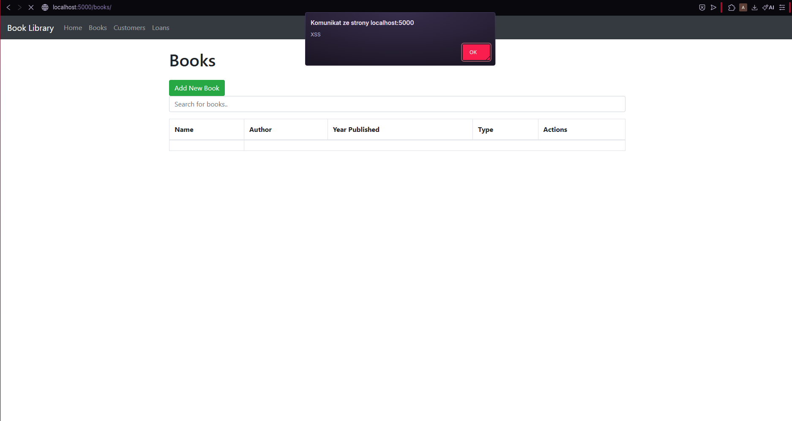
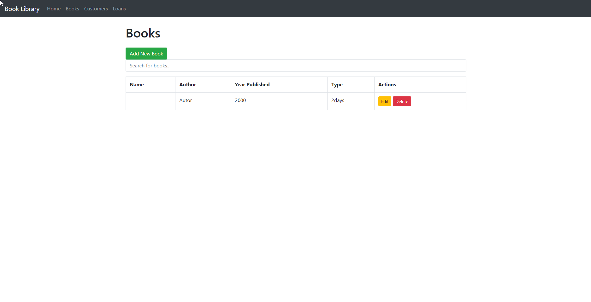
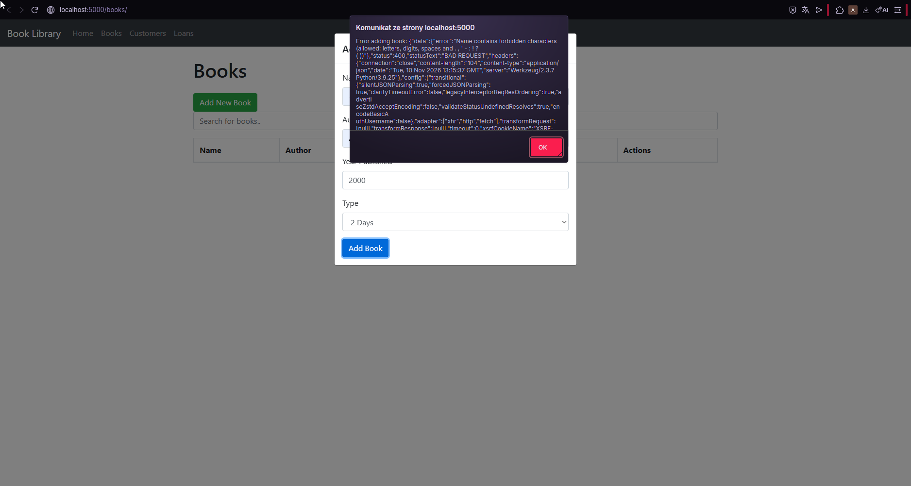
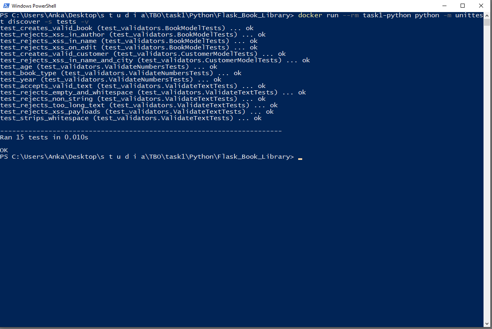

# Poprawka podatności Stored XSS w aplikacji Flask_Book_Library

## Znaleziona podatność

**Typ:** Stored (persistent) Cross-Site Scripting (XSS)

**Miejsce:**
- formularz dodawania i edycji książki (**Books**), pola `Name` i `Author`,
- formularz dodawania i edycji klienta (**Customers**), pola `Name` i `City`,
- pośrednio strona Loans, która wyświetla nazwę klienta i książki.

**Przyczyna:**
1. Backend zapisuje dane z formularzy do bazy bez żadnej walidacji (`project/books/views.py`: `create_book`, `edit_book`; `project/customers/views.py`: `create_customer`, `edit_customer`).
2. Szablony `books.html`, `customers.html` i `loans.html` wyświetlają te pola z filtrem `| safe`, który wyłącza escapowanie HTML w Jinja2.

W efekcie kod JavaScript zapisany w bazie wykonuje się w przeglądarce każdej osoby, która otworzy listę książek, klientów lub wypożyczeń.

### Sposób odtworzenia
1. Uruchom aplikację:
   ```
   cd Python/Flask_Book_Library
   docker build -t task1-python .
   docker run -p 5000:5000 task1-python
   ```
2. Otwórz http://localhost:5000/books/ i kliknij Add New Book.
3. W polu Name wpisz `<script>alert('XSS')</script>`, pozostałe pola uzupełnij dowolnie i kliknij Add Book.
4. Odśwież stronę Books. Wyświetla się okno `alert` z napisem „XSS”, za każdym razem przy otwarciu strony.

### Dowód

Formularz dodawania książki z payloadem w polu Name. Aplikacja przyjmuje dane bez walidacji:



Po odświeżeniu listy książek przeglądarka wykonuje wstrzyknięty skrypt:



Książka została zapisana w bazie. Kolumna Name jest pusta, bo przeglądarka zinterpretowała jej zawartość jako znacznik `<script>`:



### Skutki
Atakujący może wykonać dowolny kod JS w kontekście aplikacji u innych użytkowników, np. wykraść ciasteczka sesji, podmienić treść strony albo wykonać akcje w imieniu ofiary.

## Wprowadzona poprawka

Walidacja jest wykonywana **w backendzie, przy tworzeniu obiektu**, czyli w modelach, a nie przy wyświetlaniu.

- **`project/validators.py` (nowy plik)** zawiera funkcje walidujące:
  - `validate_text`: tekst 1–64 znaków, whitelista: litery (także polskie), cyfry, spacja oraz `. , ' - : ! ? ( )`. Odrzucane są m.in. `< > " ; & / =`, więc nie da się zapisać znaczników HTML/JS.
  - `validate_year`: liczba całkowita od 1 do bieżącego roku.
  - `validate_age`: liczba całkowita od 1 do 120.
  - `validate_book_type`: tylko wartości z listy `2days`, `5days`, `10days`.
- **`project/books/models.py`, `project/customers/models.py`**: walidatory podpięte przez `@validates` z SQLAlchemy. Uruchamiają się przy każdym przypisaniu atrybutu, czyli zarówno w konstruktorze (tworzenie), jak i przy edycji. Nie da się utworzyć ani zmienić obiektu z niepoprawnymi danymi.
- **`project/books/views.py`, `project/customers/views.py`**: obsługa `ValueError`. Niepoprawne dane zwracają `400 Bad Request` z komunikatem błędu zamiast błędu serwera.

Po poprawce ten sam payload jest odrzucany z kodem 400, a książka nie trafia do bazy:



## Testy jednostkowe

`tests/test_validators.py` zawiera 15 testów obejmujących wariant poprawny i niepoprawny:
- poprawne dane (w tym polskie znaki, `O'Brien`, `J.R.R. Tolkien`) są akceptowane,
- payloady XSS (`<script>`, ``, `<svg onload>`, `javascript:` itd.) są odrzucane,
- puste, za długie i nietekstowe wartości oraz niepoprawne liczby są odrzucane,
- XSS jest odrzucany przy tworzeniu i przy edycji modeli `Book` i `Customer`.

Uruchomienie:
```
cd Python/Flask_Book_Library
docker build -t task1-python .
docker run --rm task1-python python -m unittest discover -s tests -v
```

Wynik: wszystkie 15 testów przechodzi.


